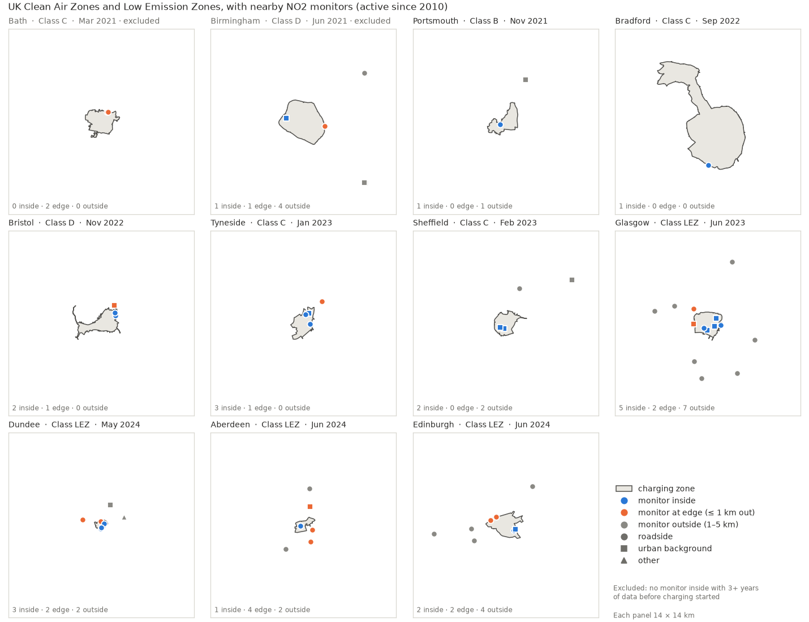

# CAZ-analysis

[](https://github.com/PatrickBolton/caz-analysis/actions/workflows/ci.yml)

**Did the UK's Clean Air Zones clean the air, and which design works best?**

> 🚧 **Work in progress.** Data pipeline complete; causal analysis under way. Numbers below are checks of the method, not findings.

Since 2021, seven English cities have introduced charging Clean Air Zones (Class B, C or D) and four Scottish cities Low Emission Zones. Existing evaluations study one city at a time, each with its own method, so their results cannot be compared. This project estimates every zone with one pipeline, and will turn the results into a decision tool for cities still considering a zone.



## Progress

| Phase | Status |
|---|---|
| 0. Feasibility: monitors per zone, zone boundaries | ✅ |
| 1. Data pipeline: PostGIS, 10 million hourly values, validated and cleaned | ✅ |
| 2. Causal analysis: Birmingham replication ✅ and robustness ✅; all zones ⏳ | 🔄 |
| 3. Pooling across zones; Class C vs D | planned |
| 4. Scenario tool and dashboard | planned |
| 5. AI assistant over the results | planned |

## What works today
- `scripts/build_database.py` and `scripts/load_hourly.py` build the database and load the hourly data (resumable).
- About 200 tests run in CI, including database tests against a throwaway Postgres.
- `scripts/replicate_liu2023.py` and `scripts/robustness_liu2023.py` repeat a published study and stress-test the result.

## Findings so far
- **The data are right.** Annual means recomputed from our 10 million hourly values match the networks' published statistics exactly.
- **The published Birmingham result is reproducible, and fragile.** Liu et al. (2023) used synthetic control. Repeated at the two of their sites in the national network, our estimates have the same sign but are 0.4-0.8 µg/m³ larger reductions (A4540, first 7 months: -1.29 vs -0.84). The robustness checks show:
  - the A4540 estimate hinges on one control site (-0.1 to -4.4 µg/m³ depending on the controls);
  - placebo sites with no zone show "effects" as large, so neither site's effect is significant;
  - one of the paper's control sites (Portsmouth) started its own zone during the study.
- **Standard intervals are too narrow on real data.** They passed in simulation but excluded zero at 50-70% of placebo sites. Uncertainty will come from placebo tests instead.

## Known limitations
- Most zones have only 1-3 monitors inside. Bath and Birmingham have none usable, so they are excluded; Bristol is the only English Class D zone analysed.
- The Air Quality England network has been offline since October 2026, and councils' own monitors are not yet included.
- Results so far cover two Birmingham sites only.

## Questions
1. How much did each zone reduce NO2, after removing the effects of weather and national trends?
2. Does the effect last, or fade as fleets modernise everywhere? Did it start once the council decided, before charging?
3. Does charging private cars (Class D, Scottish LEZs) reduce NO2 more than charging only commercial vehicles (Classes B/C)?
4. For a city considering a zone, what reduction should it expect, with what uncertainty?

## Methods in brief
- **Data.** Hourly NO2, PM2.5 and modelled weather from the UK monitoring networks (openair files), in PostGIS.
  - Monitors are labelled inside, at the edge (≤ 1 km out) or outside each zone boundary.
  - Cleaning: NO2 below -5 µg/m³ is treated as missing; a day needs 18 of 24 hours; a week needs 5 of 7 days.
- **Weather normalisation.** Per monitor, a random forest predicts NO2 from time and ERA5 weather. Predicting again with the weather resampled gives NO2 under average weather.
- **Counterfactual.** Synthetic control: a weighted mix of monitors in cities without a zone that tracks the treated monitor before the zone.
- **Checks.** Simulation with a known effect, placebo sites and dates, leave-one-control-out, and the published Birmingham study.
- **Next.** Staggered difference-in-differences across all zones, effects by year since launch, anticipation, and Bayesian pooling of zones with few monitors.

## Running locally
Needs [uv](https://docs.astral.sh/uv/) and Docker.

```bash
uv sync                                   # Python 3.12 and dependencies, as pinned in uv.lock
uv run pytest                             # tests
cp .env.example .env                      # then set POSTGRES_PASSWORD in .env
docker compose up -d --wait               # Postgres 18 + PostGIS + pgvector on localhost:5432
uv run --env-file .env python scripts/build_database.py      # reference tables, sites, views
uv run --env-file .env python scripts/load_hourly.py         # hourly data (~300 MB; resumable)
uv run --env-file .env python scripts/check_hourly.py        # vs openair's annual statistics
uv run --env-file .env python scripts/replicate_liu2023.py   # Birmingham check
uv run --env-file .env python scripts/robustness_liu2023.py  # its robustness checks
uv run --env-file .env python scripts/make_figures.py        # the map above
uv run --env-file .env pytest -m db       # database tests (throwaway caz_test database)
docker compose down                       # stop (data kept in a Docker volume)
```

## Licences
Code: MIT (see `LICENSE`). Data:
- Air quality © Crown copyright (DEFRA), OGL v3.0; cite openair (Carslaw & Ropkins, 2012).
- Weather: ERA5 (Copernicus Climate Change Service) via Open-Meteo (CC BY 4.0).
- Zone boundaries: councils (Sheffield: OGL; Birmingham, Bradford, Portsmouth: no licence stated) and OpenStreetMap (© OpenStreetMap contributors, ODbL 1.0). `data/reference/zone_boundaries.geojson` is under the ODbL.
